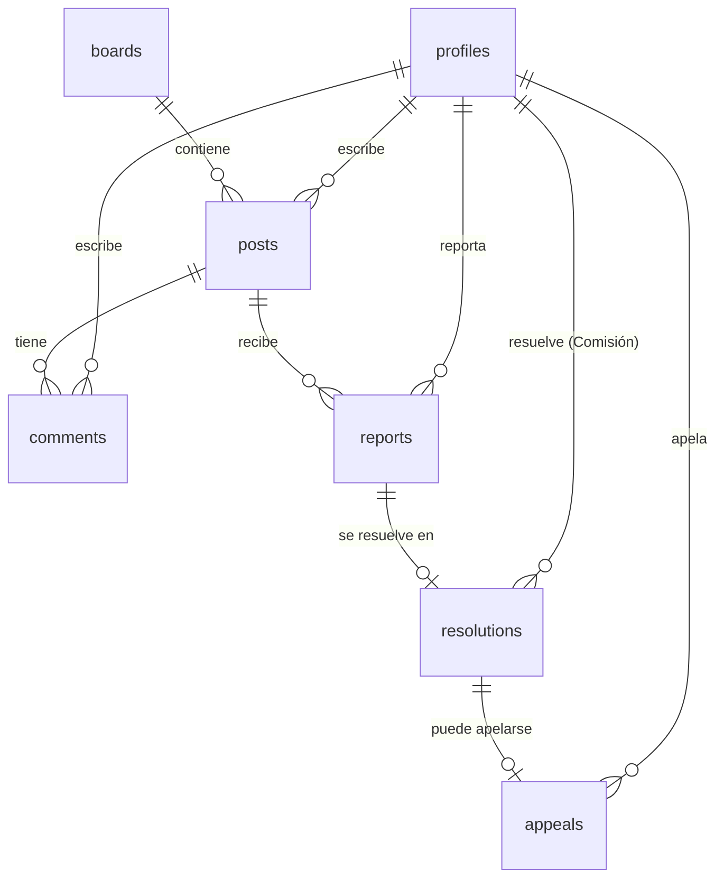

# Modelo de datos (puntos 12 y 13)

Recupera las variables de la Etapa 4: año que cursa, tablón de cada publicación, resultado de cada resolución (reporte descartado, post borrado, borrado con ban de 3 días, derivado al docente asesor) y apelación (sin apelar, se mantuvo, se revirtió). El script reproducible está en `db/`.

| Tabla | Clave primaria | Claves foráneas | Restricciones principales |
|---|---|---|---|
| `profiles` | `id` (= `auth.users.id`) | `id → auth.users` | `alias` único (3–20, `[A-Za-z0-9_]`); `anio` 1–7; `especialidad` solo desde 4°; `rol` ∈ estudiante/moderador/admin |
| `boards` | `id` | — | `slug` único |
| `posts` | `id` | `board_id → boards`, `author_id → profiles` | título 5–120, cuerpo 5–4000; `estado` publicado/borrado coherente con `borrado_por` (autor/moderacion) |
| `comments` | `id` | `post_id → posts`, `author_id → profiles` | cuerpo 2–1000 |
| `reports` | `id` | `post_id → posts`, `reporter_id → profiles` | único (`post_id`, `reporter_id`); motivo permitido; «otro» exige detalle ≥ 10 |
| `resolutions` | `id` | `report_id → reports` (único), `moderator_id → profiles` | `resultado` ∈ descartado/post_borrado/borrado_ban_3d/derivado_asesor |
| `appeals` | `id` | `resolution_id → resolutions` (único), `apelante_id`, `resuelta_por → profiles` | `estado` pendiente/mantenida/revertida; coherencia con `resolved_at` |

Relaciones 1 a 1: una resolución por reporte, una apelación por resolución («sin apelar» = no hay fila). No hay borrados físicos: las claves foráneas no tienen `on delete cascade` (salvo `profiles → auth.users`).

Cómo cada KPI sale de estas tablas: tiempo de búsqueda → encuesta (fuera de la base); publicaciones y cuentas activas → `posts` + `profiles.anio`; reportes resueltos y reversión → `reports`, `resolutions`, `appeals` (función `estadisticas()`).
